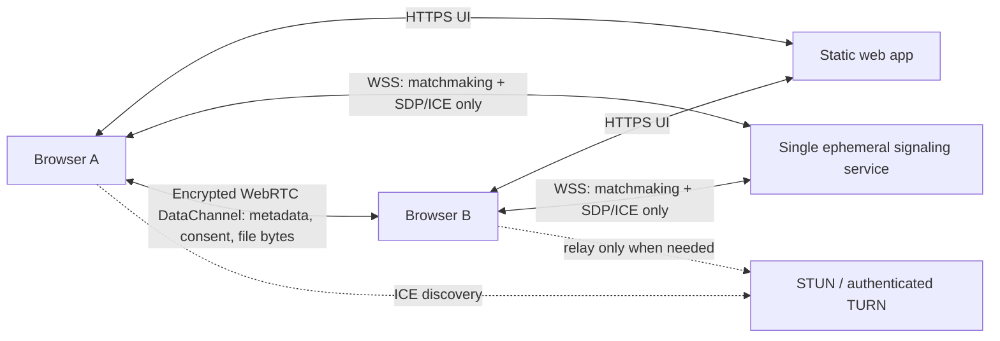
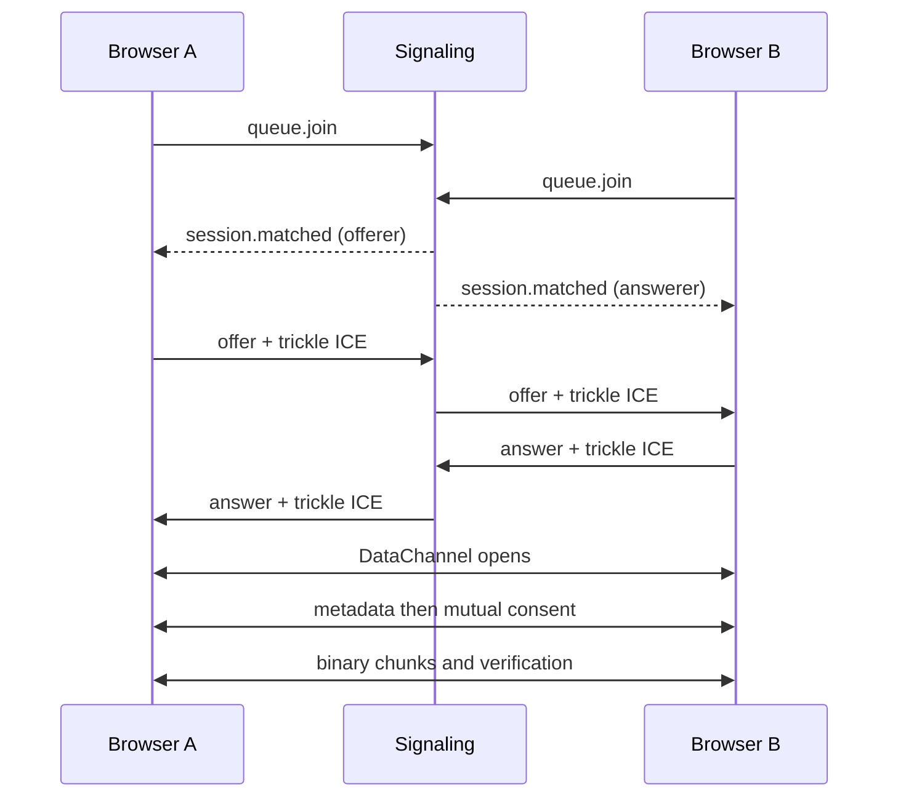

# ByteRoulette architecture

ByteRoulette exchanges files browser-to-browser over an ordered, reliable WebRTC DataChannel. The signaling service only pairs sockets and relays versioned SDP/ICE negotiation messages. It has no database and never accepts file metadata, hashes, chunks, or contents.

## Trust and privacy boundaries

- Browsers are mutually untrusted. All peer control frames, metadata, chunk order, byte counts, and hashes are validated.
- DTLS protects DataChannel traffic in transit, including when TURN relays it. TURN can observe connection metadata but not DataChannel plaintext.
- Signaling observes IP addresses and negotiation timing as operational metadata. Logs must omit SDP, ICE, filenames, sizes, hashes, and contents.
- TURN credentials are short-lived and minted by the signaling tier from a server-only shared secret.
- No account, database, Redis, object storage, analytics, advertising, or tracker exists.

## Signaling lifecycle

The initial deployment requires exactly one signaling process because all queue/session ownership is in memory. A restart deliberately ends all active work. Horizontal signaling scale would require an explicitly approved coordination redesign.

## Runtime configuration

Every environment variable is validated before service startup. Only `VITE_PUBLIC_*` values may enter the browser build. TURN shared secrets and internal limits remain server-side. Production rejects missing TURN configuration.

## Application state machine

The exhaustive states and legal transitions live in `packages/protocol/src/state-machine.ts`. Terminal/error states return only through an explicit retry or reset; no visual state is inferred independently from transport state.
